# End-to-End DevSecOps Pipeline: Node.js on AWS EKS

A hands-on DevSecOps project. A full-stack **Task Board** app (HTML/CSS/JS frontend, Node.js + Express backend, MongoDB database) is built, tested, security-scanned and containerised by **Jenkins**, then deployed to **Amazon EKS** with **GitOps (ArgoCD)**. All AWS infrastructure is created with **Terraform**.


## Table of contents
1. [Tech stack](#tech-stack)
2. [How the pipeline works](#how-the-pipeline-works)
3. [Project structure](#project-structure)
4. [Step-by-step walkthrough](#step-by-step-walkthrough)
5. [Results](#results)
6. [Troubleshooting notes](#troubleshooting-notes)
7. [Cost and cleanup](#cost-and-cleanup)
8. [Future improvements](#future-improvements)

## Tech stack

| Area | Tools |
|---|---|
| App | Node.js, Express, MongoDB (Mongoose), vanilla JS frontend |
| Testing | Jest, Supertest |
| CI | Jenkins (declarative pipeline) |
| Code quality | SonarQube |
| Security scanning | Trivy (filesystem scan and image scan) |
| Containers | Docker, Docker Hub |
| Infrastructure as Code | Terraform |
| Orchestration | Amazon EKS (Kubernetes) |
| GitOps / CD | ArgoCD |
| Cloud | AWS (EC2, VPC, EKS, ELB) |

## How the pipeline works

1. A developer pushes code to **GitHub**.
2. **Jenkins** checks out the code and runs these stages:
   1. `NPM Install`: installs dependencies
   2. `NPM Test`: runs the Jest tests
   3. `Trivy FS Scan`: scans source and dependencies for vulnerabilities
   4. `SonarQube Analysis`: static code analysis
   5. `Docker Build`: builds the image, tagged with the build number
   6. `Trivy Image Scan`: scans the built image
   7. `Docker Push`: pushes the image to Docker Hub
   8. `Update Deployment File`: writes the new image tag into `k8s/deployment.yaml` and commits it back to Git
3. **ArgoCD** (running in EKS) detects the Git change and syncs the cluster automatically.
4. **EKS** rolls out the new pods, and the app is reachable through an AWS load balancer.

Git is the single source of truth for what runs in the cluster (GitOps).

## Project structure

```
.
├── app.js, server.js          # Express app and entry point
├── routes/, models/           # REST API and MongoDB model
├── public/                    # Frontend (HTML, CSS, JS)
├── tests/                     # Jest tests (database is mocked)
├── Dockerfile
├── docker-compose.yml         # Local app + MongoDB
├── Jenkinsfile                # CI pipeline
├── k8s/                       # Kubernetes manifests watched by ArgoCD
│   ├── deployment.yaml
│   ├── service.yaml           # type LoadBalancer
│   └── mongo.yaml
├── argocd/application.yaml    # ArgoCD Application definition
├── terraform/
│   ├── jenkins-server/        # EC2 for Jenkins (Terraform)
│   └── eks/                   # VPC + EKS cluster (Terraform)
└── docs/                      # Architecture diagram and screenshots
```

## Step-by-step walkthrough

### 1. The application (local)
A Task Board where tasks can be added, completed and deleted. Data is stored in MongoDB.

```bash
docker compose up --build      # open http://localhost:3000
npm test                       # 5 tests, database mocked
```

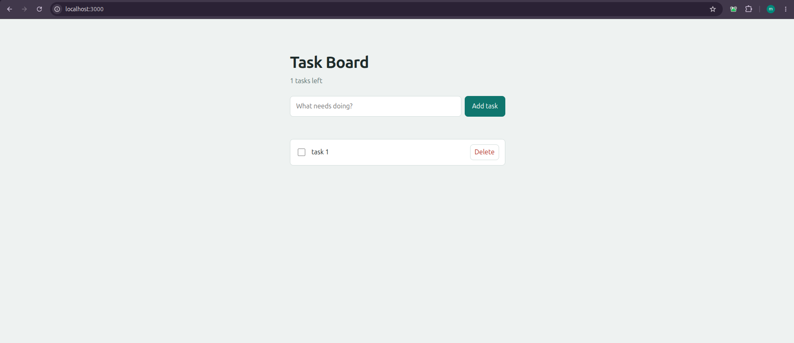

### 2. Source code on GitHubgit
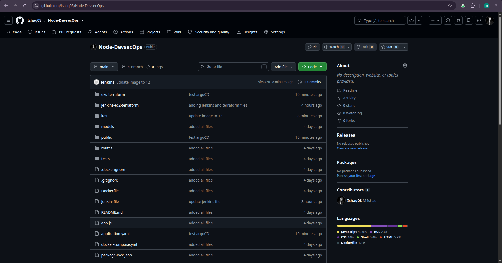

### 3. Jenkins server on EC2 (Terraform)
Terraform creates an Ubuntu 24.04 EC2 instance (`t3.medium`), an SSH key pair, and a security group that only allows my own IP. A boot script installs Java, Docker and Jenkins. Trivy and SonarQube (Docker container) were then installed on the same server.

```bash
cd terraform/jenkins-server
terraform init
terraform apply -var="my_ip_cidr=<my-ip>/32"
```

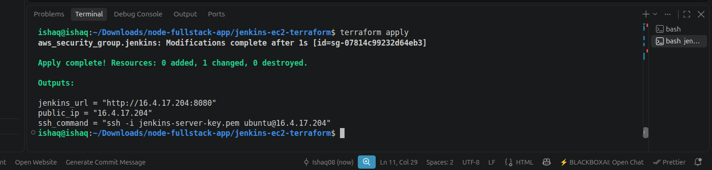
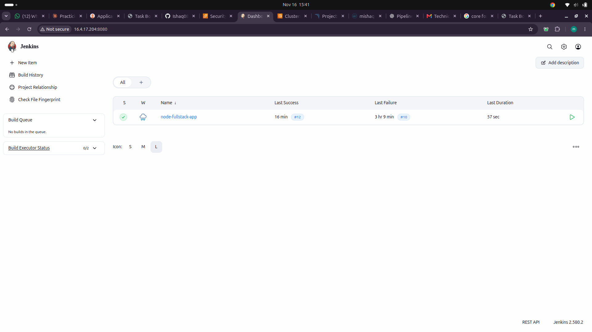

### 4. Jenkins configuration
- Plugins: NodeJS, SonarQube Scanner, Docker Pipeline, Pipeline Stage View
- Tools: `node18`, `sonar-scanner`
- Credentials: `dockerhub`, `github`, `sonar-token` (stored in Jenkins, never in the repo)
- Job type: Pipeline script from SCM (reads the `Jenkinsfile` from this repo)

### 5. CI pipeline results
All 8 stages pass on every build.

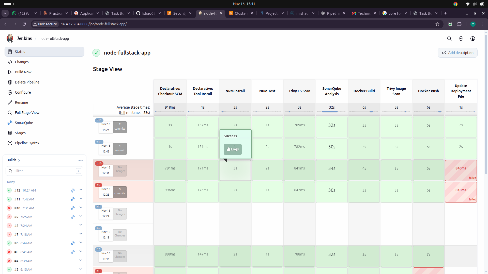

**SonarQube analysis**
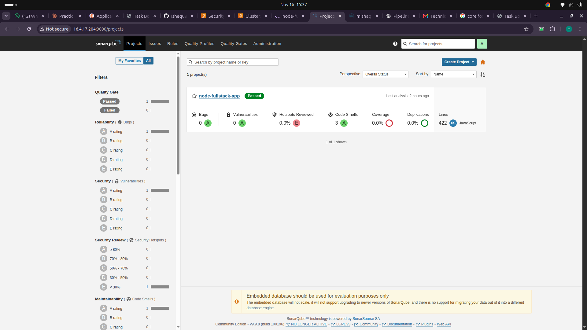

**Trivy scan output**
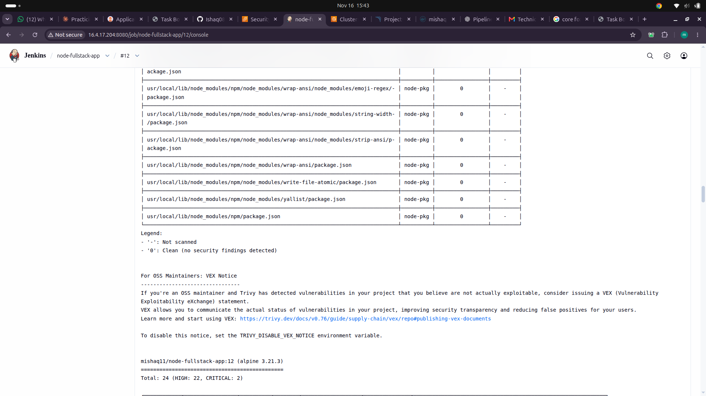

**Image pushed to Docker Hub**
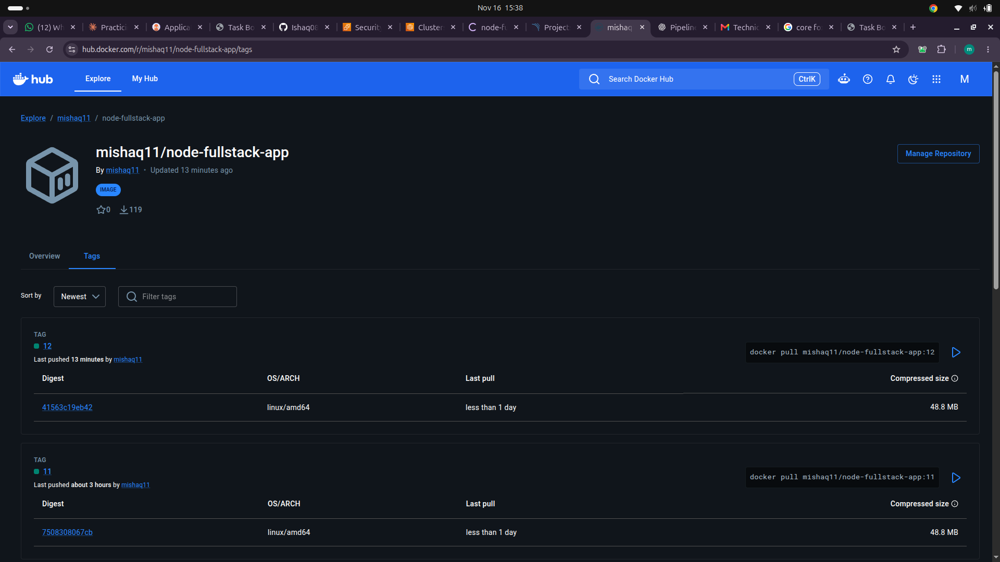

**Jenkins commits the new image tag back to Git**
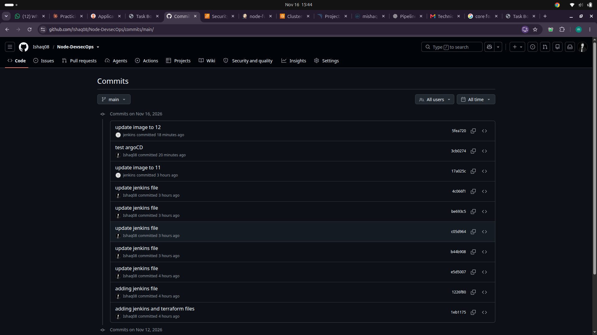

### 6. Amazon EKS (Terraform)
Terraform (using the `terraform-aws-modules/vpc` and `terraform-aws-modules/eks` modules) creates a VPC with public and private subnets, a single NAT gateway, an EKS cluster and a managed node group of 2 `t3.medium` nodes.

```bash
cd terraform/eks
terraform init
terraform apply
aws eks update-kubeconfig --region ap-south-1 --name devsecops-eks
kubectl get nodes
```

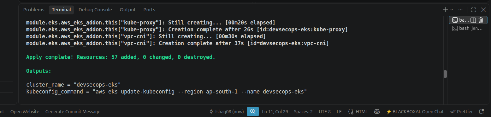
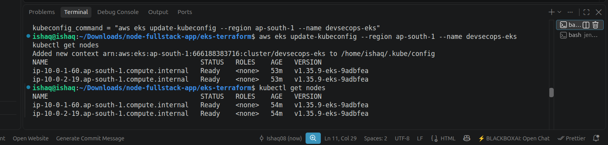

### 7. ArgoCD (GitOps)
```bash
kubectl create namespace argocd
kubectl apply -n argocd --server-side --force-conflicts \
  -f https://raw.githubusercontent.com/argoproj/argo-cd/stable/manifests/install.yaml
kubectl apply -f argocd/application.yaml
```
The Application watches the `k8s/` folder on `main` with automated sync, prune and self-heal enabled.

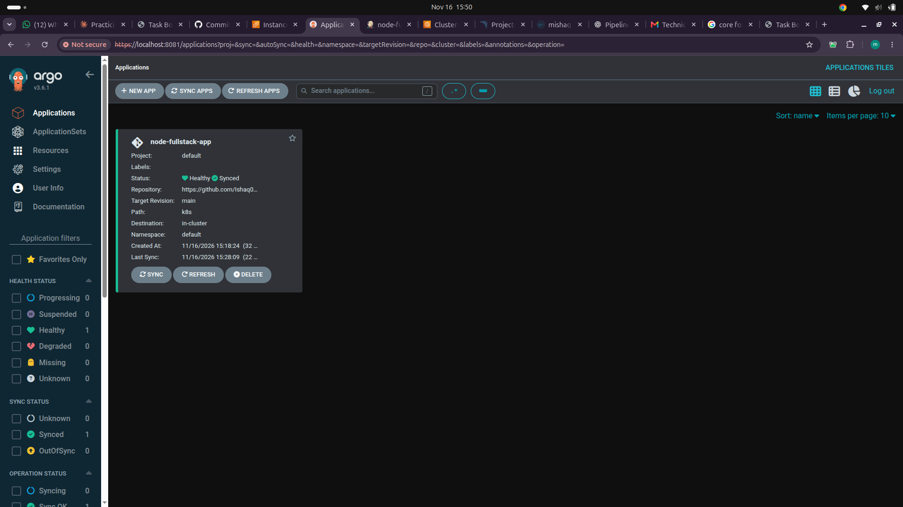
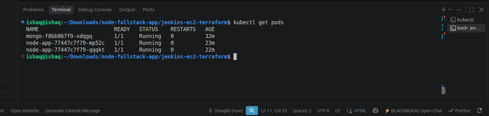

### 8. The app running on EKS
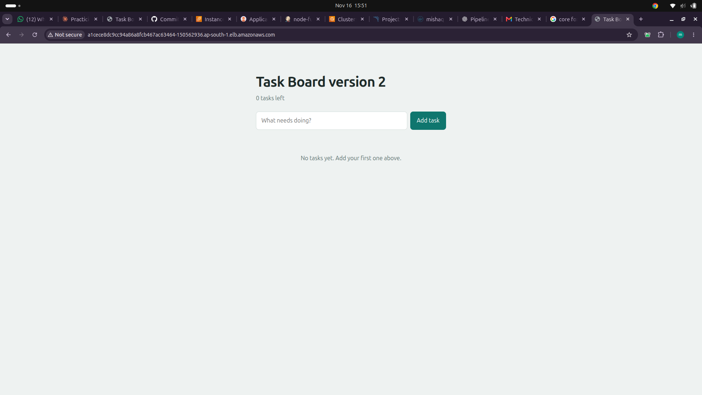

### 9. Full loop test
I changed the page heading, pushed to GitHub and ran the pipeline. Jenkins built and pushed a new image and committed the new tag. ArgoCD rolled out the new pods with no manual `kubectl` command, and the change appeared on the load balancer URL.


## Results

- A code change goes from `git push` to a running update on EKS with no manual deployment step.
- Every build runs automated tests, a dependency/filesystem scan, static analysis and an image scan.
- All infrastructure can be created and destroyed from code (`terraform apply` / `terraform destroy`).

## Troubleshooting notes

| Problem | Cause | Fix |
|---|---|---|
| `sed: can't read k8s/deployment.yaml` in Jenkins | The `k8s/` folder was not pushed to GitHub | Commit and push the `k8s/` folder |
| `ImagePullBackOff` in EKS | Placeholder image name or tag missing in Docker Hub | Use the real image and tag; keep the Docker Hub repo public |
| `kubectl apply -f k8s/` path does not exist | Command run from the wrong folder | Run it from the project root |
| Jenkins apt key error | Jenkins rotated its repository signing key | Use the current 2026 key from `pkg.jenkins.io` |
| SonarQube will not start | Missing kernel setting | `sysctl -w vm.max_map_count=262144` |

## Cost and cleanup

EKS costs roughly $5 to $6 per day while running (control plane, 2 nodes, NAT gateway), so it is destroyed after practice:

```bash
kubectl delete application node-fullstack-app -n argocd
kubectl delete -f k8s/
cd terraform/eks && terraform destroy
```

Never commit `*.tfstate`, `.terraform/` or `*.pem` files. The `.gitignore` files in this repo exclude them.

## Future improvements

- Fail the build on critical Trivy findings and on a failed SonarQube quality gate
- Persistent database storage using an EBS volume (the MongoDB pod currently uses temporary storage)
- Automatic builds on push (webhook or polling) with a guard against build loops
- HTTPS with a custom domain, plus monitoring with Prometheus and Grafana
